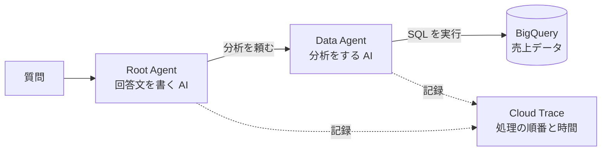

# #3 Economics：AI エージェントに任せると、何が変わるか

ある会社では、売上や粗利益の数字の問い合わせが月に数百件届き、分析担当の人が 1 件ずつ対応しています。この仕事を AI エージェントに任せると、何が良くなり、何に気をつける必要があるでしょうか。

AI エージェントは、人より速く答えられます。ただし、使うたびに料金がかかり、答えの正しさも確かめる必要があります。また、同じエージェントでも、作り方によって費用や時間が変わります。

**品質・時間・費用のトレードオフを見て、どの作りを採用するかを決める。これが AI の費用対効果、AI Economics の考え方です。**

## この回で決めること

この品質なら、どの仕事まで AI エージェントに任せられるか。その条件で、費用は見合うか。

最後に、次の 4 つを自分の言葉で説明できれば、この実習の目標に届いています。

1. どの仕事（用途）に使うか
2. どの作りを採用するか
3. 採用しても、人が確かめる必要がある点
4. 参考の月額（AI の料金と、人が確かめる時間を分けて）

実務では、作る前に概算し、小さく試して使用量や品質を測り、本導入の見積もりを更新します。この実習は、その小さな試作品を用意した状態から始めます。実際に動かして測った数字を、見積もりの根拠にします。

この実習では、次の 2 つの段階で比べます。

| 段階 | 比べるもの | 考えること |
|---|---|---|
| 1．人からエージェントへ | 分析担当の人が答える場合と、AI エージェントが答える場合 | 速さと費用はどれだけ違うか。答えの正しさはどうか |
| 2．エージェントの中の改良 | #2 で見つけた無駄（同じ分析を 2 回頼む）がある作りと、それを直した作り | 品質を保ったまま、費用と時間をどれだけ減らせるか |

登場するものの関係は、次のとおりです。



Root Agent が Data Agent に分析を頼み、Data Agent が BigQuery で集計します。それぞれの処理は Cloud Trace に記録されるので、あとから「何を何回頼み、何秒かかったか」を確かめられます。

当日は、次の流れで進めます（時間は目安です）。

| 時間の目安 | 手順 | ここで確かめること |
|---|---|---|
| 0–15 分 | 手順 0〜1：開始確認と、質問の送信を始める | 比べるための結果を用意する（質問は自動で進む） |
| 15–35 分 | 手順 2：待つ間に、分析担当の役をやってみる | 人が対応すると、何に時間がかかるか。作りを直すと、費用と時間がどう変わりそうか（予測） |
| 35–55 分 | 手順 3〜4：記録を 1 件たどり、全部をまとめて比べる | 処理の中で何が減り、何が残るか。人と比べてどうか。作りを直すと、どれだけ変わるか |
| 55–65 分 | 手順 5：AI の回答を、人の目で確かめる | 両方のやり方の回答を読み、必要な答えが得られているか、そのまま渡せるか |
| 65–95 分 | 手順 6：自分の会社なら、どれを選ぶか | どの仕事に、どの作りを使うか（使わないか） |
| 95–120 分 | 共有と、バックアップ・片付けの案内 | 選んだ判断と理由を話し、今日分かったことをまとめる |

#1・#2 に参加していない方も、このまま進められます。

### 手順書の読み方

- 番号の付いた操作とコマンドは、上から順に行います。
- **【考える】** は、自分の考えを一言メモするか、隣の人と話す所です。決められないときは、迷っている点で構いません。済んだら先へ進みます。
- ▶ の折りたたみは、見出しに書かれた方・場面のときだけ開きます。該当しなければ、開かずに次へ進みます。

## 手順 0．開始前の確認

[Summit の開始確認](checkpoint.md)で `開始できます。` と表示されたことを確認してから始めます。Cloud Shell を開き直した場合は、教材フォルダへ移動します。

```sh
cd ~/summit-workshop
```

<details>
<summary>開始確認が時間内に終わらない方・途中で操作が遅れた方だけ</summary>

講師に声をかけてください。自分の環境がなくても、講師が用意した[記録例](lab3-example.md)（同じ 6 回を事前に実行した結果）を使って、次の順で最後まで進められます。

| 手順 | 環境がない場合にすること |
|---|---|
| 1 | 飛ばす（コマンドは打たない） |
| 2-1 | SQL は実行せず、講師が見せる実行結果を見る |
| 2-2・2-3 | そのまま考えて、予測を書く |
| 3 | 講師がスクリーンに映す Trace と、記録例のページの「[Q01 の処理の内訳](lab3-example.md#q01-の処理の内訳手順-3)」を見る |
| 4 | 記録例のページの「[やり方ごとの合計](lab3-example.md#やり方ごとの合計手順-4-4)」と「[質問ごとの結果](lab3-example.md#質問ごとの結果)」の数字を使う |
| 5 | 記録例のページの「[Q08 の回答文](lab3-example.md#q08-の回答文手順-5)」を読む |
| 6 | 計算済みの標準ケースから選ぶ。数字を変えたい場合は[試算シート](#試算シート)を使う |

講師の記録例は、[講師の記録例のページ](lab3-example.md)にあります。講師が同じ 6 回を事前に実行した結果で、自分の環境や Cloud Shell がなくても、GitHub で読めます。

準備が整ったら、手順 1 から自分の環境で追いついて構いません。

途中で操作が遅れたときも、同じ表のとおり、その手順だけ記録例を使って先へ進みます。**【考える】** の所は、記録例の数字を使って参加します。

</details>

## 手順 1．エージェントへの質問を始める（3 分）

**ここで確かめること：** 比べるための結果を用意します。ここでは質問を送るだけで、結果は手順 3 以降で読みます。

この実習では、質問を受けて回答文を書く AI を **Root Agent**、Root Agent から頼まれて分析をする AI を **Data Agent** と呼びます。同じ問い合わせに答える次の 3 つを比べます。

| 答える側 | やり方 | 比べること | どこで |
|---|---|---|---|
| 分析担当（あなた） | 社内のクエリ集から SQL を選んで実行する。クエリ集にない質問は、自分で SQL を考える | 比べる基準 | 手順 2 で体験する |
| AI エージェント（Data Agent・毎回取得） | Root Agent が、分析担当の AI（Data Agent）に **2 回**分析を頼む（#2 で見つけた無駄がある作り） | 人と比べて、速さ・費用・正しさはどうか | このコマンドで自動で質問する |
| AI エージェント（Data Agent・再利用） | Data Agent には **1 回**だけ頼み、結果を使い回す（#2 の無駄を直した作り） | 毎回取得と比べて、費用と時間はどれだけ減るか | このコマンドで自動で質問する |

Root Agent は、**#2 の Web 画面で使ったのと同じもの**です（事前イベントに参加していない方は、この実習で初めて使います）。Root Agent は、開始確認で用意した分析エージェント「EC分析 ③ 業務定義あり＋集計View」（Data Agent）に分析を頼みます。2 つのやり方に、次の 3 つの質問を 1 回ずつ、合計 6 回答えさせます。

| 問題 | 質問 | 性質 |
|---|---|---|
| Q01 | 2026年8月の純売上はいくらですか。 | よくある決まった集計 |
| Q04 | 2026年7月と比べて8月の粗利益が最も減ったカテゴリと、8月から7月を引いた差額を教えてください。 | カテゴリごとに 2 か月を比べる分析 |
| Q08 | 2026年9月も同じセールを実施すれば、必ず粗利益が増えますか。 | 次の月の施策について判断する質問 |

6 回を手で 1 回ずつ送る代わりに、次のコマンドでまとめて送ります。どの回も同じ条件で、時間と費用が記録されます。

```sh
cd ~/summit-workshop && uv run --locked python3 -m workshop.benchmark run --preset summit
```

**確認：** 最初の約 1 分は環境を確かめ、`開始確認：OK` と表示されます。続けて `これから、あなたの Project の AI エージェントに 6 回質問を送ります` と出ます。`1/6 Q01 Data Agent・毎回取得 に質問しています…` と表示されたら、**あなたの Project の AI エージェントに、実際に質問が届いています**。1 回終わるごとに `→ 終わりました（52 秒）` のように表示されます。全体で 6〜7 分ほどかかります（目安。回によって変わります）。終わるのを待たずに、手順 2 へ進みます。

> 実行中は、同じエージェントに別の質問を送らないでください。費用を集めるときに、どの質問の分か区別できなくなります。
>
> **全部送り終えた後に、このコマンドをもう一度実行すると、新しく 6 回送ります**（その分の費用もかかります）。途中で止まった場合だけ、同じコマンドで続きから再開します。

## 手順 2．待つ間に、分析担当の役をやってみる（10 分）

**ここで確かめること：** 人が対応すると、何に時間がかかるか。エージェントの作りを直すと、費用と時間がどう変わりそうか（予測）。

エージェントが答えている間に、あなたが**分析担当の人**として、同じ質問に答えてみます。

### 2-1．Q01 に答える（3 分）

上司から、Q01 の問い合わせが届きました。会社には、よく使う SQL をまとめた[社内のクエリ集](#付録社内のクエリ集)があります。

1. ブラウザの新しいタブで BigQuery（ https://console.cloud.google.com/bigquery ）を開きます（Mac は ⌘、Windows は Ctrl を押しながらリンクを押すと、新しいタブで開きます）。
2. 左の「エクスプローラ」に、自分の Project ID が出ていることを確かめます。BigQuery は最後に開いていた Project で開くので、違う Project が出ていたら、画面上部の Project の名前を押して切り替えます。一覧は表示名で並ぶので、ID の列で自分の Project を探します（[困ったとき](#困ったとき)の `Not found` の行も参照）。
3. ホーム画面の「**新規作成**」にある「**SQL クエリ**」（+ ボタン）を押し、社内のクエリ集の「1．8 月の純売上」を貼り付けて、「**実行**」を押します。
4. 画面下の「**結果**」タブに出た数字を、メモしておきます。

**決まった質問なら、クエリ集があれば人でもすぐ答えられます**。実際の仕事で時間がかかるのは、依頼が届いてから手が空くまでの待ち時間です。

### 2-2．クエリ集にない問い合わせが来たら（4 分）

続けて、次の Q04 と Q08 が届きました。どちらもクエリ集にはありません。

- **Q04**：2026年7月と比べて8月の粗利益が最も減ったカテゴリと、8月から7月を引いた差額を教えてください。
- **Q08**：2026年9月も同じセールを実施すれば、必ず粗利益が増えますか。

**【考える】** **クエリ集にない質問が来たら、あなたはどうしますか**。自分で SQL を書くか、誰かに頼むか。答えが返ってくるまで、どれくらいかかりそうかを考えてください（実行はしません）。

エージェントがこの 2 つにどう答えたかは、手順 4・5 で確かめます。

### 2-3．毎回取得と再利用は、どこが違うのか（3 分）

手順 1 で見たとおり、Root Agent は Data Agent に分析を頼み、返ってきた集計結果をもとに回答文を書きます。ここで比べる 2 つの作り方は、**Data Agent に何回頼むか**だけが違います。毎回取得は、#2 で Cloud Trace を使って見つけた「同じ分析を 2 回頼む」無駄がある作りで、再利用はそれを直した作りです。

Root Agent・Data Agent・BigQuery の関係は、[全体の地図](map.md#登場するもの)の図で確かめられます。

| 作り方 | 中身 |
|---|---|
| Data Agent・毎回取得 | 回答を作るときと、回答の数字を確かめるときで、Data Agent に **2 回**頼む |
| Data Agent・再利用 | 1 回目に返ってきた集計結果を使い回し、Data Agent には **1 回**だけ頼む。数字の確認は省かない |

今回変えるのは、モデルや指示文ではなく、アプリが分析結果を取り直すか、同じ依頼の中で共有するかという作りです。実務でも、同じ結果を複数の処理が別々に取りに行っていないかを、処理の記録で確かめます。質問や集計条件が同じか、その間にデータが更新されていないか、結果を見てよい人が同じかなど、共有してよい条件を確認し、変更後の品質・時間・費用を比べます。

この教材の作りでは、2 回目に頼んだ結果を 1 回目の結果と見比べているわけではありません。そのため、頼む回数を 1 回に減らしても、数字の確認が弱くなるわけではありません。本当に品質が変わらないか、費用と時間がどれだけ減るかを、数字で確かめます。

**【考える】** **予測してみましょう**。頼む回数を 2 回から 1 回にすると、費用と時間はそれぞれ半分になると思いますか。結果を見る前に、一言メモするか、隣の人と話しておきます。答え合わせは手順 4-4 で行います。

## 手順 3．Console で、Q01 の記録を 1 件たどる（8 分）

**ここで確かめること：** 依頼を 2 回から 1 回に減らすと、処理の中で何が減り、何が残るか。

手順 1 の `run` が終わってから始めます。ターミナルに「質問の結果」の短い表が出ていなければ、出るまで待ちます。

ここでは、Q01 の記録を Google Cloud Console の **Cloud Trace** で自分の目でたどります。Cloud Trace は、1 回の処理の中で何がどの順に動き、それぞれ何秒かかったかを記録する画面です。全部の回を見る必要はありません。代表の 1 件だけを見て、手順 4 の表の数字の裏付けにします。

「質問の結果」の表の下に、次の手順で開くリンクが表示されています。

```text
次の手順で開くリンク（Q01 の記録）
  Root Agent の処理（Data Agent・毎回取得）：https://console.cloud.google.com/traces/explorer;traceId=…
  Root Agent の処理（Data Agent・再利用）：https://console.cloud.google.com/traces/explorer;traceId=…
  Data Agent の処理（Data Agent・再利用）：https://console.cloud.google.com/traces/explorer;traceId=…
```

使うのは、上の 2 本（Root Agent の処理）です。3 本目は [Challenge](#challenge) で使います。

リンクが「記録がまだ届いていません」と出た場合や、開いても表示されない場合は、1〜2 分待ってから、次のコマンドでリンクを表示し直します。

```sh
cd ~/summit-workshop && uv run --locked python3 -m workshop.benchmark links
```

それでも比べる Trace を開けない場合は、講師がスクリーンに映す Trace と、記録例のページの「[Q01 の処理の内訳](lab3-example.md#q01-の処理の内訳手順-3)」で確かめて先へ進みます。

### 操作

「**Root Agent の処理（Data Agent・毎回取得）**」と「**Root Agent の処理（Data Agent・再利用）**」のリンクを 2 つのタブで開き、切り替えて比べます。見るのは、次の 3 か所だけです。

| 見る場所 | 意味 |
|---|---|
| `data_agent.ask_data_agent` の行 | Data Agent に分析を頼んだ処理。**この行の数を数えます** |
| 各行の右の青い棒 | その処理にかかった時間。長いほど時間がかかっている |
| `catalog.fetch_definition` の行 | 業務定義を取り出す処理。どちらのやり方でも同じだけかかる |

左の列は、上から起きた順に並んでいます。字下げされた行は、上の行の中で動いた処理です。

### 確認できたら次へ

- 毎回取得では `data_agent.ask_data_agent` が **2 本**、再利用では **1 本**になっている
- **【考える】** 全体の時間の差は、主にどの行のぶんか。依頼を減らしても残っている時間（業務定義の取得や、Root Agent が考える時間）はどれか

### 費用は、どう計算しているか

Data Agent の料金は、AI が読み書きした量（トークン数）で決まります。その量も Cloud Trace に記録されています。ここでは**講師が 1 件だけ、記録から量を拾って価格を掛け、費用を出すところを見せます**。自分で探して計算したい方は、[Challenge](#challenge) で試せます。

<details>
<summary>計算の例（Q01・再利用。講師の記録例とは別の、2026-10-12 の回。読むのは任意）</summary>

[Data Agent の価格](https://cloud.google.com/products/data-agents/pricing)は、2026 年 10 月に確認した時点で、入力 100 万トークンあたり 3 USD、出力 100 万トークンあたり 20 USD です。この回の Data Agent は、入力 38,067 トークン、出力 461 トークンでした。

```text
38,067 × 3 ÷ 1,000,000 ＋ 461 × 20 ÷ 1,000,000 ＝ 0.1142 ＋ 0.0092 ＝ 約 0.123 USD
```

Data Agent の AI は、考えるたびに業務定義やテーブルの説明を最初から読み直します。そのため入力が大半を占め、費用の大半も入力のぶんです。実行のたびに数字は少し変わります。

</details>

1 件でも、記録を探して数字を拾い、計算する手間がかかります。6 回分すべてを、Root Agent の AI と BigQuery の分まで含めて手で調べるのは大変です。

そこで、この教材では、同じ作業をまとめて行う道具を用意しました。**Google Cloud の機能ではなく、この教材のために作ったプログラムです。** Cloud Trace の記録と BigQuery のジョブ履歴を API で読み出し、実行ごとに突き合わせます。そこに教材に書き写した公表価格を掛けて、費用を計算します。

そのため、表示される金額は**実際の請求額ではなく、参考の見積もり**です。Data Agent は 2026 年 12 月 31 日まで無料試用中なので、今は請求されません。表示は、試用が終わった後の価格で計算しています（実際の請求額は Cloud Billing のレポートで確認できますが、反映まで時間がかかり、1 回ごとの内訳も分かりません）。

## 手順 4．全部をまとめて比べる（12 分）

**ここで確かめること：** ここでは 2 つを比べます。

1. 人に頼む場合と比べて、AI エージェントは何が良く、何が残るか（4-3）
2. エージェントの作りを直すと、費用と時間がどれだけ変わるか（4-4）。回答の中身は、手順 5 で読んで確かめます

4-1・4-2 は、その数字を用意する操作です。Console では 1 回ごとの費用の合計が出ないので、手順 3 の最後で紹介した教材のプログラムで 6 回分の費用を計算し（4-1）、比べる画面を開きます（4-2）。

### 4-1．6 回分の費用を計算する

次のコマンドは、Google Cloud から Cloud Trace の記録と BigQuery のジョブ履歴を読み出し、価格を掛けて、1 回ごとの費用を計算します。計算結果は教材フォルダの中にファイルとして保存され、次の手順の画面で使います。

```sh
cd ~/summit-workshop && uv run --locked python3 -m workshop.benchmark collect --billing-mode on-demand
```

`--billing-mode on-demand` は、BigQuery の料金方式（使った分だけ払う方式）の指定です。会社の Project で BigQuery の容量課金（Editions など）を契約している場合は、講師に相談してください。

**確認：** やり方ごとの短い表（答えた回数・参考費用の合計・処理時間の中央値）が表示されたら完了です。費用の欄に「未算出」がある場合は、表の下の文に従います。「記録がまだ届いていない可能性があります」なら、1〜2 分待って同じコマンドをもう一度実行します。「照合できません」なら、その費用は空けたまま先へ進みます。それ以外の文なら、待っても変わらないことがあるので、講師に声をかけてください。その間は、[講師の記録例](lab3-example.md)を読んで先へ進みます。未算出は 0 円という意味ではありません。

### 4-2．比べる画面を開く

```sh
cd ~/summit-workshop && uv run --locked python3 -m workshop.benchmark show
```

**確認：** `ブラウザの新しいタブで教材の画面が開きます` を含む行が表示されたら、画面が起動しています。このターミナルは画面を表示し続けるので、これ以降はコマンドを打てません（正常です）。

Cloud Shell 上部の「**ウェブプレビュー**」→「**ポート 8080 でプレビュー**」を押すと、比べる画面（「#3 の結果」）が開きます。

> この後のコマンド（`collect` のやり直し、手順 5 の `review`）は、Cloud Shell で**新しいターミナル**（+ ボタン）を開き、`cd ~/summit-workshop` で教材フォルダに移動してから実行します。

画面では、次の所を見ます。

| 知りたいこと | 画面のどこを見るか | 書き込む先 |
|---|---|---|
| AI は Q01 に、いくら・何秒で答えたか | マス目の「Q01」と「Data Agent・再利用」のマス | 4-3 の表 |
| 作りを直すと、費用・時間・依頼の回数はどう変わったか | 「やり方ごとの合計」 | 4-4 の表 |
| 回答文の中身 | マスを押した先の「回答文」 | 手順 5 で読む |

マスの「回答あり」「判断を保留」は、AI が答えたか、判断を保留したかです。回答が正しいかは、手順 5 で回答文を読んで確かめます。

### 4-3．人に頼む場合と比べる

Q01 のような質問を、分析担当（人）に頼む場合と、AI エージェントに任せる場合を比べます。エージェントの数字は画面から、人の数字は手順 2-1 の体験と下の仮定から書き込みます。**測った数字（時間）、記録から計算した参考の見積もり（費用）、仮定した数字を、区別して書きます。**

| | 人に頼む | AI エージェント（再利用） |
|---|---|---|
| Q01 の答え（正解は 240,000 円） | 手順 2-1 でメモした数字 | 画面の回答 |
| 答えが出るまで | 待ち時間を含めて半日（仮定） | 画面の処理時間（実測、約 1 分） |
| AI の実行料金 | なし | 画面の Q01 の参考費用 × 150 円（参考の見積もり。使った量の記録と公表価格から計算し、1 USD＝150 円は仮定。講師の記録例の Q01・再利用では約 22 円） |
| 人の作業 | 15 分 × 時給 5,000 円 ＝ 約 1,250 円（仮定） | 回答を確かめる時間が残る（手順 5 で体験し、手順 6 で見積もる） |
| クエリ集にない質問（Q04・Q08） | すぐには答えられない（手順 2-2） | 画面のマス目（答えたか） |

AI の実行料金は、人の作業費よりずっと小さく、答えも待たずに返ってきます。ただし、**AI の実行料金は、業務全体の費用ではありません**。回答を確かめる、間違いを直す、答えられない質問に対応する、といった人の作業は残ります。どれだけ残るかを、手順 5・6 で考えます。

人の 15 分は、依頼を読み、クエリを選んで実行し、数字を確かめて返信するまでの時間です（手順 2-1 で体験したのは、そのうち実行の部分です）。仮定の値（作業 15 分、待ち半日、時給 5,000 円、1 USD＝150 円）は、自分の会社の値に置き換えて構いません。

### 4-4．エージェントの作りを変えると、何が変わるか

同じエージェントで、Data Agent に頼む回数を 2 回から 1 回に減らしました。画面から次の数字を書き込みます。「未算出」と出た欄は空けておきます（0 円という意味ではありません）。

| | 毎回取得（2 回頼む） | 再利用（1 回だけ） |
|---|---|---|
| 参考費用（3 問の合計） | USD | USD |
| 処理時間の中央値 | 秒 | 秒 |
| Data Agent に頼んだ回数（3 問の合計） | 回 | 回 |

**【考える】** 手順 2-3 で考えた予測と、自分の数字を比べます。費用と時間は、それぞれ半分になりましたか。処理時間は、中央値の差だけで判断せず、画面のマス目で質問ごとの処理時間も見ます。予想と違ったなら、どこが違ったかを一言メモするか、隣の人と話します。

自分の結果で比べられない項目は、その項目だけ講師の記録例を読みます。自分の結果は残し、表の空欄に記録例の数字は書き込みません。

<details>
<summary>講師の記録例と比べる（自分の結果がある方は記入後に開く。結果がない方はこの例を使う）</summary>

講師の記録例は、教材の検証の結果です。画面の「講師の記録例と比べる（あなたの結果ではありません）」や、[講師の記録例のページ](lab3-example.md)でも見られます。

- 費用：講師の記録例では、3 問の合計が 0.938 USD から 0.465 USD に下がりました（−50%）。費用の大半は Data Agent なので、頼む回数が半分になると、費用もほぼ半分になりました。
- 時間：処理時間の中央値は 86.5 秒から 44.8 秒でした（どちらのやり方でも答えた同じ 3 問の中央値）。質問ごとに見ると、講師の記録例では Q01 が 50.7 秒から 44.8 秒（−12%）、Q04 が 203.7 秒から 124.3 秒（−39%）、Q08 が 86.5 秒から 32.8 秒（−62%）で、短縮幅は質問ごとに違いました（[質問ごとの結果](lab3-example.md#質問ごとの結果)）。また、Q01 の Trace を見ると、Data Agent への依頼が 1 本減っても、Trace 全体は 42.0 秒と 41.4 秒でほとんど同じでした（[Q01 の処理の内訳](lab3-example.md#q01-の処理の内訳手順-3)）。減った依頼のぶん、再利用のほうで Root Agent の AI が考える時間が長かったためです。業務定義の取得や AI が考える時間は、頼む回数を減らしても残り、回によって長さが変わります。
- ぶれ：講師の記録例とは別の回（2026-10-12）では、3 問の合計の費用が −21%（BigQuery 分の一部を計算できず、上限の値で数えた比較）、時間の中央値が −9% でした。1 回の依頼の中で Data Agent の AI が何回考え直すかは、回によって変わるからです。

**講師の記録例では、無駄な依頼を 1 回減らすと、費用が下がりました。** 回答の中身が保たれていたかは、手順 5 で読んで確かめます。 ただし、処理時間は一律に半分になるとは限りません。各条件 1 回の実行では、変更の効果と実行ごとの変動を切り分けられません。再利用のほうが長くなる回もありますが、それだけで実行がおかしいとは言えません。採用の前に、同じ条件で繰り返して確かめます。

</details>

## 手順 5．AI の回答を、人の目で確かめる（10 分）

**ここで確かめること：** 両方のやり方の回答を読んで、必要な答えが得られているか、そのまま上司に渡せるかを確かめます。

業務定義を渡していても、AI が書いた SQL のちょっとした書き方の違いで、数字を間違えることがあります（事前イベントで参加者から報告された例。教材側では SQL の原本を確かめていません）。また、数字が正しくても、説明に誤解を招く書き方が混ざることがあります。

### 5-1．Q01・Q04 の答えを照らし合わせる

画面のマス目で、Q01 と Q04 の「Data Agent・毎回取得」と「Data Agent・再利用」のマスを順に押し、「回答文」を読みます（環境がない方は、記録例のページの「[Q01・Q04 の回答文](lab3-example.md#q01q04-の回答文手順-5)」）。次の答えと、数字だけでなく、期間と意味まで合っているかを確かめます。

| 質問 | 照らし合わせる答え |
|---|---|
| Q01 | 2026年8月の純売上：240,000円 |
| Q04 | 7月と比べて8月の粗利益が最も減ったカテゴリ：Electronics、8月−7月の差額：−64,000円 |

### 5-2．Q08 の回答を読む

Q08「2026年9月も同じセールを実施すれば、必ず粗利益が増えますか。」は、データからは言い切れない質問です。決まった答えの文と比べるのではなく、次の点を読んで確かめます。

1. 画面のマス目で、Q08 の「Data Agent・毎回取得」と「Data Agent・再利用」のマスを順に押します（環境がない方は、記録例のページの「[Q08 の回答文](lab3-example.md#q08-の回答文手順-5)」）。
2. 「回答文」を読みます。
3. 「必ず増える」と言い切っていないかを確かめます。
4. 回答に添えられた数字が正しいかを確かめます。
5. 理由の説明に、言い過ぎや飛躍がないかを確かめます。たとえば、前月より減ったという数字だけから、セールの効果まで確かめたように書いていないか。また、**教材の 9 月のデータは月の途中までしかありません**（9 月の初めまで）。途中の月の数字を、7・8 月と同じように並べて比べていないかも見ます。

### 確認できたら次へ

**【考える】** 次の 4 つについて、一言メモするか、隣の人と話します。

1. 確かめた回答に、問題は見つかったか（見つからなかった／あった／判断できない）。2 つのやり方で違いはあったか
2. この回答を、そのまま渡せるか
3. 直すなら、どこをどう直すか
4. この確認を、実際の仕事では誰が担うか（分析担当か、質問した人か、ほかの誰か）

<details>
<summary>確かめた例（講師の記録例の回答）</summary>

Q01・Q04 は、両方のやり方とも、上の答えと期間・意味まで合っていました。Q08 は、どちらも「必ず増えるとは言えない」と答えていました。そのうえで、人が Q08 について次のことを確かめました。

- **毎回取得**：根拠として、8 月の Electronics の粗利益が「前月比-64,000円（当月は-24,000円の赤字）」という数字を挙げています。教材のデータで確かめると、金額は正しい（7 月 40,000 円 → 8 月 −24,000 円）。ただし、続く「セール実施によってすべてのカテゴリで粗利益が増加するわけではないことが確認されています」は言い過ぎです。前月より減ったことからは、セールの効果までは確かめられません。結論は「金額は正しい。セールとの因果関係を確かめたように読める表現は直してから渡す」
- **再利用**：「対象期間：2026年9月1日〜2026年9月30日」と書いていますが、9 月の実績の数字を並べて比べてはいません。確かめられたのは、この点までです。回答全体が正しいと確かめ終えたわけではありません

添えられた数字の正しさと、説明の飛躍の両方を、人が確かめます。回によって回答文は変わります。

</details>

**答えの数字が正しくても、そのまま渡せるとは限りません**。エージェントを入れても、人が確かめる時間は残ります。この時間を、手順 6 の月額に入れます。

<details>
<summary>確かめた結果を記録する（任意）</summary>

記録すると、画面のその回の記録の「人の確認」に反映されます（画面を再読み込みします）。記録の下に出ている「実行 ID」を `RUN_ID` の代わりに入れ、`--decision` には渡してよければ `pass`、直す必要があれば `fail` を、`--note` には自分が確かめた内容を書きます。画面を表示しているターミナルは使えないので、新しいターミナルで実行します。

```sh
cd ~/summit-workshop && uv run --locked python3 -m workshop.benchmark review --run-id RUN_ID --decision pass --note '自分が確かめた内容'
```

</details>

## 手順 6．自分の会社なら、どれを選ぶか（30 分）

**ここで確かめること：** 自分の会社なら、どの仕事に、どの作りを使うか（使わないか）を決めて、4 つに分けて書きます（下の「判断を書く」）。これが、この実習のゴールです。

進め方：下の 2 つの場面から、自分の仕事に近いほうを 1 つ選ぶ → その場面の月額と、人が確かめる作業を見る → 仮の判断を書く → 隣の人に理由を話す → 講師の例を見て、必要なら直す。自分の会社の具体的な用途がある方は、試算シートで件数や確かめる割合を変えて、その用途で書いても構いません。

表を読むときは、「選んだ場面では、品質・時間・費用のどれを重く見るか」を考えます。

下の表は、2 つの場面の月額を、教材の標準の仮定で計算したものです。**AI の実行料金だけでなく、人が回答を確かめる作業も入れています**。

| | 経営会議の資料 | 社内チャットの質問窓口 |
|---|---|---|
| どんな質問か | 決まった指標。間違いは許されない | 誰でも自由に聞く。言い回しもさまざま |
| 件数（仮定） | 月に 4 回 | 1 日に 300 回（月 9,000 回） |
| 人が確かめる件数（仮定） | 全件（4 件） | 1 割（900 件） |
| 1 件を確かめる時間（仮定） | 10 分 | 10 分 |
| 人だけで対応した場合 | 約 5,000 円 | 約 1,125 万円（2,250 時間、約 14 人分） |
| 再利用：AI の実行料金 | 約 96 円 | 約 22 万円 |
| 人が確かめる作業（どちらのやり方でも同じ） | 約 3,330 円 | 約 75 万円（150 時間、約 1 人分） |
| **再利用：合計** | **約 3,430 円** | **約 97 万円** |
| 毎回取得：合計 | 約 3,520 円（うち AI 約 186 円） | 約 117 万円（うち AI 約 42 万円） |

計算に使った値は次のとおりです。

- 人の作業：時給 5,000 円（仮定）。人だけで対応する場合は 1 件 15 分（手順 4-3 の仮定）。約 14 人分・約 1 人分は、1 人が月 160 時間働くとして計算
- AI の実行料金：1 件あたり、再利用 0.16 USD・毎回取得 0.31 USD、1 USD＝150 円。講師の記録例の 3 問の合計（再利用 0.465 USD・毎回取得 0.938 USD）を 3 で割り、小数第 2 位に丸めた標準値です。Data Agent の試用が終わった後の価格で計算しています。自分の数字を使う場合は、手順 4-4 の「3 問の合計」を **3 で割って** 1 件あたりにします（3 問すべての費用がそろった場合だけ）。未算出がある場合は標準値を使い、上限の値を含む場合はそう書き添えます。この 1 件あたりは教材の 3 問の平均で、自社の質問の構成で測った値ではありません
- 人が確かめる作業：1 件 10 分は、回答を読んで確かめる時間だけです
- **含めていない費用**：間違った回答を直す時間や、答えられなかった質問に人が代わりに答える時間、エージェントを作る・直す作業、動かし続けるための監視や運用、ほかの Google Cloud のサービスの料金、間違った回答が使われたときの影響

人が確かめる件数と時間は、推奨値でも実測値でもなく、計算のための仮定です。

### 試算シート

件数・確かめる割合・時給などを自社の値に変えて試したい方だけ使います（任意）。標準値で考える方は、上の表のまま「判断を書く」へ進みます。

講師が先に、試算シートのコピーを作り、入力欄を 1 つ変えて、金額が変わるところを見せます。試す方は、そのあと手元で同じ操作をします。[試算シート（Google スプレッドシート、閲覧のみ）](https://docs.google.com/spreadsheets/d/1pLNnYmldSzcw6_O6ALXErKiIozIEC0wKE3e22tsYZi0/edit)を開き、「ファイル」→「コピーを作成」で自分のコピーを作ってから、色の付いた入力欄だけを書き換えます。標準の値のままなら、上の表と同じ金額になります。

シートを開けない場合は、上の表の 2 つの場面から近いほうを選んで、そのまま次へ進んで構いません。

### 判断を書く

**【考える】** いま考えている仮の判断を、次の 4 つに分けて、試算シートの[「採用判断」タブ](https://docs.google.com/spreadsheets/d/1pLNnYmldSzcw6_O6ALXErKiIozIEC0wKE3e22tsYZi0/edit?gid=110606#gid=110606)の黄色の欄か、手元のメモに書きます。シートに書く場合は、「ファイル」→「コピーを作成」で自分のコピーを作ります（試算シートをすでにコピーした方は、そのコピーの「採用判断」タブに書きます）。コピーは任意です。

1. どの仕事（用途）に使うか
2. 採用する作り（人／毎回取得／再利用）と、その理由（品質・時間・費用のどれを重く見たか）
3. 採用しても、人が確かめる必要がある点（何を、何件、誰が）
4. 参考の月額（AI の料金と、人が確かめる作業を分けて）

手順 5 で確かめた回答について、「問題を見つけなかった」「問題があった」「判断できない」のどれだったかも書き添えます。費用が下がっても、回答に問題があれば、それも含めて採用を考えます。

あわせて、使った数字が自分の結果か、講師の記録例かを書いておきます。決めるのに情報が足りなければ、「今回は判断を保留し、この情報を集める」でも構いません。

### 隣の人と話す

講師の合図で、隣の人と選んだ作りと理由を 1 分ずつ話します。まだ書けていない方は、迷っている点を話してください。

### 別の考え方と比べる

話し終えたら、次の例を開きます。正解ではなく、別の考え方の例です。読んで考えが変わったら、判断を直します。

<details>
<summary>考え方の例</summary>

経営会議：どの作りでも月数千円で、人だけでも月 5,000 円です。費用は決め手にならず、効くのは正しさと確かめやすさです。全件を人が確かめる前提なら、エージェントを入れても人の手間はあまり減りません。決まった集計なら、クエリ集で人が答えるのも十分な選択肢です。

社内チャット：人だけでは月 2,250 時間、約 14 人分の作業になり、回りません。エージェントに任せると、AI の料金と確かめる作業を合わせて月約 100 万円、確かめる時間は約 150 時間です。毎回取得と再利用の差は月約 20 万円なので、品質が同じなら再利用を選びます。ただし「1 割を確かめれば足りる」は仮定です。金額の大きい回答や、経営の判断に使う回答など、どれを確かめるかを決めることが、人の時間の使い道になります。

</details>

## まとめ：今日分かったこと

書いた 4 つが、この実習の成果です。このあとの共有の時間に、何人かに選んだ判断と理由を話してもらいます。

この実習で確かめたことは、次の 3 つです。

1. 今回の記録と教材の仮定を比べると、AI の回答時間と実行料金は小さかった。ただし、人が回答を確かめる作業も費用に含める必要がある（手順 4-3・5・6）
2. 講師の記録例では、無駄な依頼を減らした作りで費用が下がった。品質・時間・費用への効果は、同じ条件で繰り返して確かめる（手順 3・4-4）
3. どの作りがよいかは、場面によって変わる。正しさが決め手の仕事と、件数と費用が効く仕事で、選び方が違う（手順 6）

実務では、ここで書いた判断を出発点に、自分の仕事の質問で小さく試し、品質・時間・費用を測って見積もりを更新します。

## 困ったとき

| 状況 | どうするか |
|---|---|
| 開始確認や `run` が時間内に終わらない | 講師に声をかける。手順 0 の「環境がない場合にすること」の表に沿って、講師の記録例で最後まで進める。自分の環境での実行は、後から追いつけばよい |
| `run` がエラー文だけを出して止まった | 同じ `run --preset summit` をもう一度実行すると、まだ送っていない質問から再開する。失敗した質問は自動ではやり直さない。全部送り終えた後に実行すると、新しく 6 回送るので注意 |
| `collect` を何度実行しても、ある回の費用が未算出のまま | 表の下の文を読む。「失敗した回の費用は計算しません」なら、その回は失敗している（画面のマス目で「実行失敗」）。使った量が全部は分からないので計算しない。その質問は比較から外して読む |
| BigQuery で `Not found` と出る | 左のエクスプローラに自分の Project ID が出ているか確かめる。違えば画面上部の Project の名前を押して切り替える |
| 費用の未算出が多い | 表の下の文に従う。「記録がまだ届いていない可能性があります」なら、数分待って新しいターミナルで `collect` をもう一度実行する。「照合できません」なら、その費用は空けたまま先へ進む。それ以外の文（権限、原因が分からない）なら、講師に声をかけ、その間は講師の記録例で先へ進む |
| Cloud Trace の開始時刻に「Undefined parameter - TIME_ZONE」と出る | Console の表示の問題。気にせず進めてよい |
| 「未算出（最大 … USD）」と出る | 照合できない BigQuery 分があり、候補を全部数えた上限を示している。確定値ではない |
| `Address already in use` と出る | `--port 8081` で起動し、ウェブプレビューも 8081 にする |
| BigQuery で「Studio の新機能の確認」などの案内が出た | 右上の「×」で閉じて構いません |
| ウェブプレビューで開けない | `localhost` ではなく、Cloud Shell 上部の「ウェブプレビュー」から開く |

## Challenge

### Data Agent の費用を、自分で計算する

手順 3 で講師が見せた計算を、自分の記録で行います。手順 3 のリンクの 3 本目「**Data Agent の処理（Data Agent・再利用）**」を開きます。Data Agent の中で動いた処理が並んでいます。

リンクを見失ったら、次のコマンドで表示し直します（比べる画面を表示しているターミナルでは打てないので、新しいターミナルで実行します）。

```sh
cd ~/summit-workshop && uv run --locked python3 -m workshop.benchmark links
```

| 画面の場所 | 意味 |
|---|---|
| `generate_content` | Data Agent の AI が考えている処理（目安は 2 つ）。**この行を押すと、読んだ量（トークン数）が見られます** |
| `execute_tool SQL execution` | BigQuery で集計している処理 |
| 一番上の「（スパン ID … がありません）」 | 気にしなくてよい行（呼び出し元の記録がこの画面にない、という表示） |

1. `generate_content` の行を押します。
2. 下に出る詳細の一覧から、`gen_ai.usage.input_tokens`（入力）と `gen_ai.usage.output_tokens`（出力）を探します。見つけにくいときは、右上の「**生成 AI 属性のみ**」をオンにすると、行が絞り込まれます。
3. すべての `generate_content` の分を、入力・出力それぞれ足します。
4. 入力トークン × 3 ÷ 1,000,000 ＋ 出力トークン × 20 ÷ 1,000,000 で計算し、比べる画面の Q01・再利用の Data Agent の参考費用と比べます。

> 親の `call_llm` の行にも同じ数字が付いています。**`generate_content` の行だけを数えてください**。両方を足すと 2 倍になります。

### そのほか

- Q04 のためにエージェントが書いた SQL を見る：画面のマス目で Q04 の「Data Agent・再利用」を押し、その回の「講師用：自動チェックと詳しい記録」の `evidence` にある `sql` を、手順 2-2 で考えたやり方と比べる
- [3 つの処理経路](routes.md)：Data Agent を呼ばず、教材のプログラムが決まった SQL で答える経路と比べる
- 同じ条件で繰り返す：1 回ずつの結果は、回によってぶれます。教材の検証では、毎回取得の Q04 の参考費用が、日によって 0.29 USD と約 0.73 USD（BigQuery 分を除く）でした（Data Agent が書いた SQL の本数が 2 本と 4 本で違った）- Trace Explorer で、自分で絞り込んで Data Agent の Trace を探す
- BigQuery の「ジョブ履歴」で、Data Agent が実行した SQL と、処理されたバイト数・課金されるバイト数を見る（参照するテーブル 1 つにつき最低 10 MB 課金される。`data-agent-id` のラベルで、自分がクエリ集で実行したものと見分けられる）

## 付録：社内のクエリ集

分析担当がよく使う SQL です。BigQuery の新しいクエリの画面に貼り付けて実行します。

**1．8 月の純売上**

```sql
-- 社内クエリ集 1：8 月の純売上
SELECT SUM(net_sales_jpy) AS net_sales_jpy
FROM ec_workshop.v_revenue_events
WHERE event_date >= DATE '2026-08-01'
  AND event_date < DATE '2026-09-01'
```

**2．8 月の粗利益**

```sql
-- 社内クエリ集 2：8 月の粗利益
SELECT SUM(gross_profit_jpy) AS gross_profit_jpy
FROM ec_workshop.v_revenue_events
WHERE event_date >= DATE '2026-08-01'
  AND event_date < DATE '2026-09-01'
```

**3．8 月の返金額**

```sql
-- 社内クエリ集 3：8 月の返金額
SELECT SUM(refund_jpy) AS refund_jpy
FROM ec_workshop.v_revenue_events
WHERE event_date >= DATE '2026-08-01'
  AND event_date < DATE '2026-09-01'
```

